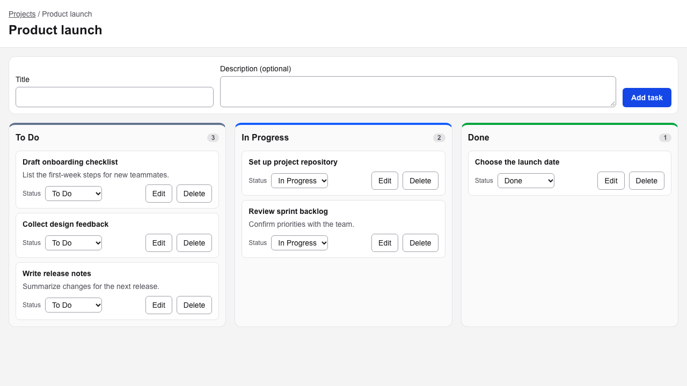
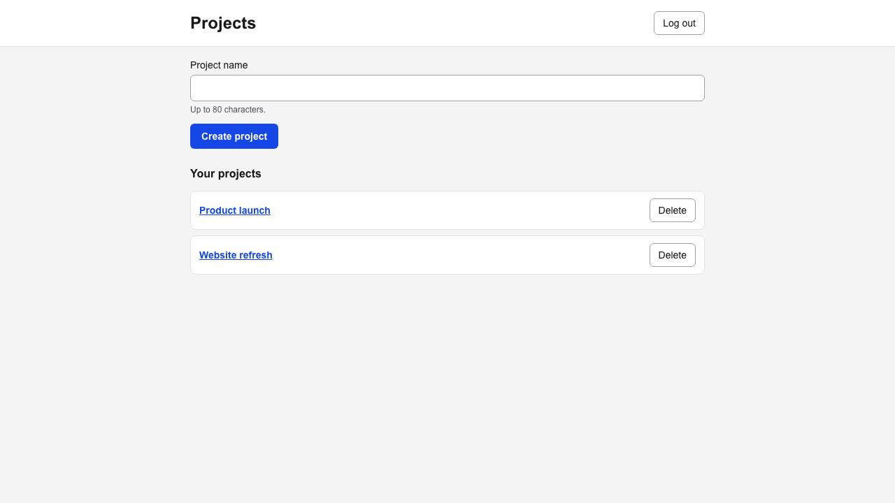
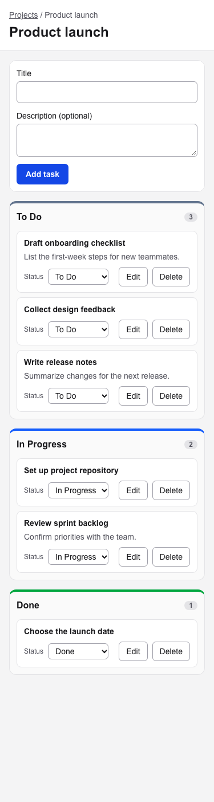

# Team Task Board

A minimal Kanban task board. Users sign up, group work into projects, and move tasks through **To Do → In Progress → Done**. Built for CS6983 Project 2 as a pair project by Haomiao Shi and Tyler Sarna; from Sprint 2 Haomiao continued it solo with the instructor's approval.

**Live app:** https://team-task-board-copilot-stonehaomiaoshi-8972.vercel.app (register, then log in) · **API docs:** [/api/docs](https://team-task-board-copilot-stonehaomiaoshi-8972.vercel.app/api/docs) · **Health:** [/api/v1/health](https://team-task-board-copilot-stonehaomiaoshi-8972.vercel.app/api/v1/health)



| Projects | Board at 375px |
|---|---|
|  |  |

## Features

- **Accounts** (#4): register and log in; the session is a JWT in an httpOnly cookie (Bearer tokens also work for API clients). Every page except `/login` and `/register` requires a session.
- **Projects** (#5): create and delete your own projects (deleting asks for confirmation and removes its tasks). Other users' projects are invisible (404).
- **Board** (#6, #8): three columns with counts and an empty state; change a task's status from its dropdown. The card moves at once and is saved through the API; if saving fails, it moves back and an error is shown.
- **Tasks** (#7, #9): add a task (title required, description optional), edit its title and description, and delete it after confirming.
- **REST API** (#7, #11, US5): every `/api/v1` endpoint is described in [docs/api/openapi.yaml](docs/api/openapi.yaml) and browsable with Swagger UI at `/api/docs`. Errors use `{ "error": { "code", "message" } }`.
- **Accessible and responsive**: native controls with labels, visible focus, announced errors; columns side by side from 768px and stacked below, with no horizontal scroll at 375px.

## Tech stack

| Layer | Choice |
|---|---|
| App | Next.js 16 (App Router, Cache Components), React 19, TypeScript 5 (strict) |
| UI | Tailwind CSS 4 |
| Data | PostgreSQL 17 (Docker locally, Neon in production), Prisma 7 with `@prisma/adapter-pg` |
| Auth and validation | `jose` (HS256 JWT), `bcryptjs`, `zod` 4 |
| Tests | Vitest 5 + Testing Library (unit, component, integration against a test database), Playwright (E2E) |
| CI/CD | GitHub Actions (checks, CodeQL, `npm audit`), Dependabot, Vercel (preview per PR, production from `main`) |

## Documentation

| Topic | Link |
|---|---|
| Product requirements (US1–US5) | [docs/prd.md](docs/prd.md) |
| Architecture and database (ER) diagrams | [docs/architecture.md](docs/architecture.md) |
| Decisions | [docs/decisions/](docs/decisions/) |
| API reference | [docs/api/openapi.yaml](docs/api/openapi.yaml) · Swagger UI at `/api/docs` |
| Visual spec and mockups | [DESIGN.md](DESIGN.md) · [docs/mockups/](docs/mockups/) |
| Sprint 1 notes | [planning](docs/sprints/sprint-1/planning.md) · [standups](docs/sprints/sprint-1/standups.md) · [review](docs/sprints/sprint-1/review.md) · [retrospective](docs/sprints/sprint-1/retro.md) |
| Sprint 2 notes | [planning](docs/sprints/sprint-2/planning.md) · [standups](docs/sprints/sprint-2/standups.md) · [review](docs/sprints/sprint-2/review.md) · [retrospective](docs/sprints/sprint-2/retro.md) |
| Shared rules for humans and AI | [AGENTS.md](AGENTS.md) |
| Scrum board | [GitHub Project](https://github.com/users/stone-coding/projects/3/views/2) · [Milestones](https://github.com/stone-coding/team-task-board-copilot/milestones) · [Issues](https://github.com/stone-coding/team-task-board-copilot/issues) |

Development uses Visual Studio Code with GitHub Copilot Chat, guided by `AGENTS.md`.

## Prerequisites

| Tool | Version | Check |
|---|---|---|
| Node.js | **22.12 or later** (Vitest 5 and Prisma 7 refuse older versions) | `node -v` |
| npm | 10 or later (ships with Node) | `npm -v` |
| Git | any recent version | `git --version` |
| Docker | Docker Desktop or Engine with Compose v2 (local PostgreSQL) | `docker compose version` |

## Local setup

**1. Clone the repository.**

```bash
git clone https://github.com/stone-coding/team-task-board-copilot.git
cd team-task-board-copilot
```

**2. Install dependencies.** `npm ci` installs the exact versions in `package-lock.json`.

```bash
npm ci
```

**3. Start PostgreSQL and apply migrations.** `docker-compose.yml` runs Postgres 17 on port 5432 with a `team_task_board` database and a separate `team_task_board_test` database for integration tests.

```bash
cp .env.example .env
docker compose up -d --wait
npx prisma migrate dev
npm run db:test:migrate
npx prisma generate
```

`migrate dev` applies `prisma/migrations/` to the development database. `npm run db:test:migrate` applies the same migrations to the test database (`TEST_DATABASE_URL`); without it the integration tests fail with "The table `public.User` does not exist". Then run `npx prisma generate` to generate the client into `src/generated/prisma/` (gitignored); Prisma 7 does not do this during `migrate dev`. After any schema change, run `npx prisma generate` and `npm run db:test:migrate` again. Stop the database with `docker compose down` (add `-v` to delete its data).

**Environment variables** (`.env.example` lists them; `.env` is gitignored and never committed):

| Variable | Used by | Local value | Vercel |
|---|---|---|---|
| `DATABASE_URL` | App and `prisma migrate` | Docker Postgres (from `.env.example`) | Pooled Neon URL, set by the Neon integration |
| `DATABASE_URL_UNPOOLED` | `prisma migrate deploy` during the Vercel build | not needed | Direct Neon URL, set by the Neon integration |
| `TEST_DATABASE_URL` | Integration tests only | `team_task_board_test` database | not set |
| `JWT_SECRET` | Signing session tokens (HS256) | any long random string: `openssl rand -base64 48` | a different random value per environment (Sensitive) |

**4. Install the Playwright browser** (once, only needed for end-to-end tests).

```bash
npx playwright install chromium
```

**5. Start the development server.**

```bash
npm run dev
```

**6. Create an account and log in.** Every page except `/login` and `/register` requires a session; signed-out visitors are redirected to `/login`.
- Open http://localhost:3000/register, enter your name, an email, and a password of at least 8 characters, and submit.
- You land on `/login`; log in with the same email and password.

**7. Open a board:** create a project at http://localhost:3000/projects and click its name. Tasks come from the tasks API (#7, #8):
- Change a card's **Status** dropdown: the card moves to that column at once, the counts update, and the change is saved. If saving fails, the card moves back and an error appears.
- Add a task with the form above the columns (title required, description optional); it appears in To Do.
- Each card has **Edit** (change title and description) and **Delete** (asks for confirmation first).
- An empty column shows **"No tasks yet"**.
- Below 768px the columns stack vertically.
- An unknown project, such as `/projects/other`, shows the not-found page.

Stop the server with `Ctrl+C`.

## Checks

```bash
npm run lint        # ESLint
npm run typecheck   # Next.js route types + TypeScript
npm test            # Vitest unit, component, and integration tests (needs Postgres running and step 3)
npm run build       # production build
npm run test:e2e    # Playwright end-to-end tests (builds and starts the app on port 3000)
```

**Definition of done** (see `AGENTS.md`), all in one go:

```bash
npm run lint && npm run typecheck && npm test && npm run build && npm run test:e2e
```

To run the production build locally: `npm run build && npm run start`.

**CI.** `.github/workflows/ci.yml` runs on every pull request to `main` and every push to it: lint + typecheck → unit and integration tests (Postgres service, `npm run db:test:migrate`) → build + Playwright E2E against the production build (Postgres service, `prisma migrate deploy`), plus a **Dependency audit** job (`npm audit --audit-level=high`). Branch protection on `main` requires the checks. A failed E2E run uploads the Playwright report as an artifact.

**Security.** `.github/workflows/codeql.yml` runs CodeQL (JavaScript/TypeScript) on pull requests, on `main`, and weekly; `.github/dependabot.yml` proposes npm and GitHub Actions updates weekly.

## Deployment guide

Production runs on Vercel with a Neon Postgres database. Every pull request gets a preview deployment with its own Neon database branch; merging to `main` deploys production.

To set up a new deployment from scratch:

1. **Import the repository** in Vercel (*Add New → Project*). Framework: Next.js. Leave the build settings alone: `vercel.json` sets the build command to `node scripts/vercel-build.mjs`.
2. **Add Neon** from the Vercel Marketplace (*Storage → Neon*), connect it to the project for Production and Preview, and enable a database branch per preview deployment. The integration sets `DATABASE_URL` (pooled) and `DATABASE_URL_UNPOOLED` (direct).
3. **Set `JWT_SECRET`** in *Settings → Environment Variables* for Production and Preview, as Sensitive, with a different random value for each (`openssl rand -base64 48`).
4. **Deploy.** Each build runs `prisma generate` → `prisma migrate deploy` over the direct connection → `next build`, so every deployment migrates its own database. Migrations must therefore stay backward compatible with the version that is running.
5. **Verify** `https://<deployment>/api/v1/health` returns `{"status":"ok","database":"ok"}`, then register and create a project.

Preview deployments are public only if Vercel's *Deployment Protection* is off; the production URL is always public.

## Project structure

```
src/app/                    Routes: pages, layouts, API route handlers (api/v1/**), Swagger UI (api/docs)
src/components/<feature>/   UI components (auth, projects, board), with tests next to them
src/components/ui/          Shared form primitives and button styles
src/lib/                    Framework-free types, zod schemas, and pure logic (board reducer, task statuses)
src/server/                 Server-only code: Prisma client (db.ts), auth, services, HTTP helpers
prisma/                     Schema and migrations
tests/unit/                 Cross-module unit tests (schema, config, OpenAPI coverage)
tests/integration/          API + database tests (use the test database)
e2e/                        Playwright specs, including the core user journey
scripts/                    Test-database migration and the Vercel build
.github/                    CI, CodeQL, and Dependabot
docs/                       PRD, architecture, decisions, API spec, mockups, screenshots, sprint notes
AGENTS.md, DESIGN.md        Shared rules and visual spec
```

## Contributing

1. Pick an issue assigned to you on the Project board.
2. Branch from `main`: `feature/<issue>-<slug>`, `fix/…`, `chore/…`, or `docs/…`.
3. Commit the failing test first as `test(#N): …`, then `feat(#N): …`.
4. Run the definition of done, then open a PR titled `[#N] Summary` with `Closes #N`.
5. Before merging, review your own diff against the checklist in AGENTS.md §7 (partner review in Sprint 1; self-review since the project went solo in Sprint 2), wait for green CI, and merge with a merge commit.

The full rules are in [AGENTS.md](AGENTS.md).

## Troubleshooting

| Problem | Fix |
|---|---|
| `Port 3000 is in use` | Stop the other server, or run `npm run dev -- -p 3001` |
| `npm run test:e2e` tests an old app | Playwright reuses a server already on port 3000 locally; stop that server first |
| `npm run test:e2e` cannot find a browser | Run `npx playwright install chromium` |
| `npm test` crashes before running tests | Upgrade to Node 22.12 or later |
| `Cannot find module '@/generated/prisma/client'` | Run `npx prisma generate` |
| `docker compose up` fails: port 5432 is already allocated | Another Postgres is running; stop it, or map another host port and update `DATABASE_URL` in `.env` |
| `npm test`: "The table `public.User` does not exist" | The test database has no tables: run `npm run db:test:migrate` |
| `npm test`: "Can't reach database server" | Start Postgres with `docker compose up -d --wait` |
| A board (`/projects/<id>`) sends you to `/login` | You are signed out: register at `/register`, then log in (step 6) |

## HW3

Individual HW3 materials (rules experiment, report, and evidence) are on the [`hw3-haomiao`](https://github.com/stone-coding/team-task-board-copilot/tree/hw3-haomiao) branch and are not part of the P2 codebase.
