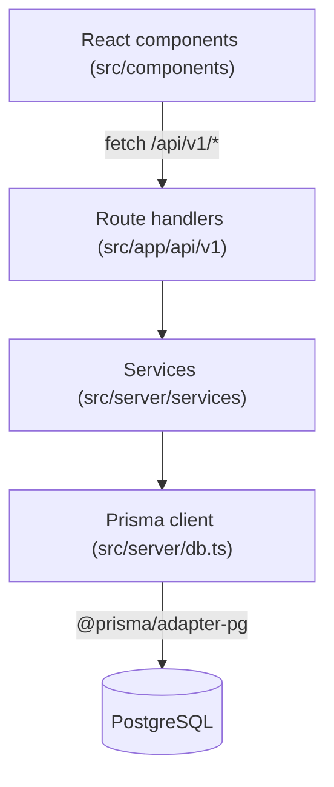
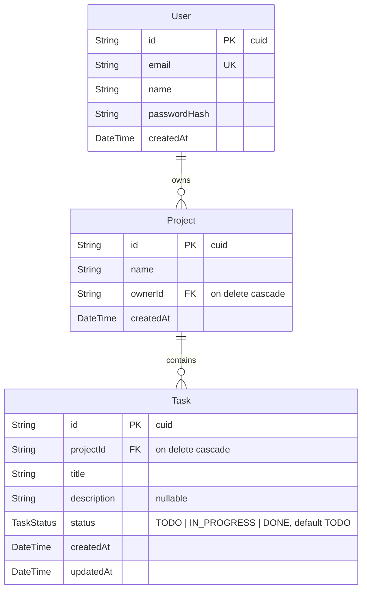

# Architecture

Requirements and the data model are in [prd.md](prd.md) §6–§7; the rules are in [AGENTS.md](../AGENTS.md). Update this file with any schema or layer change.

## Layers

`src/server/db.ts` builds one `PrismaClient` with the `PrismaPg` driver adapter from `DATABASE_URL`, cached on `globalThis` outside production so Next.js hot reload does not open new connection pools.

## Database schema

Source: `prisma/schema.prisma`; migrations in `prisma/migrations/`.

`Task` has an index on `(projectId, status)` for loading a board's columns.
