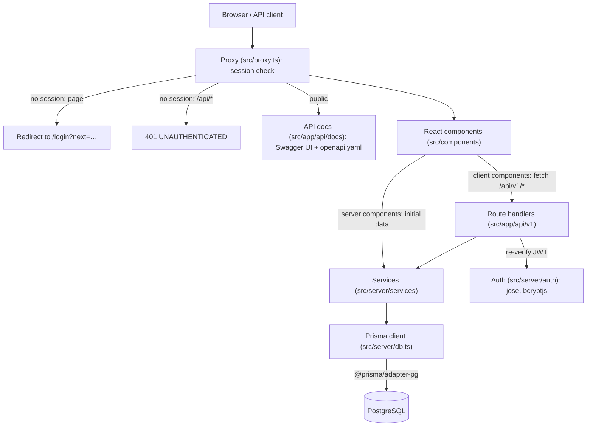
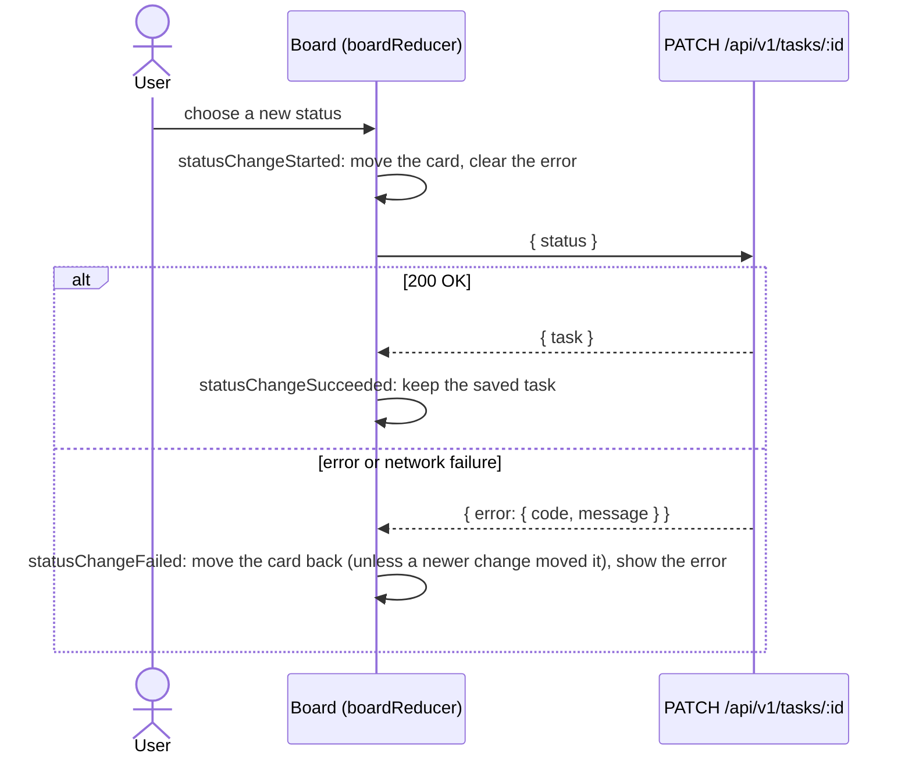
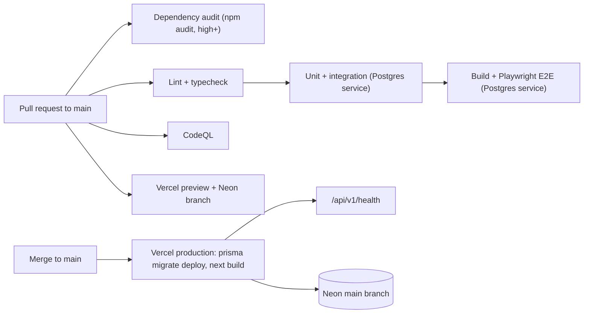
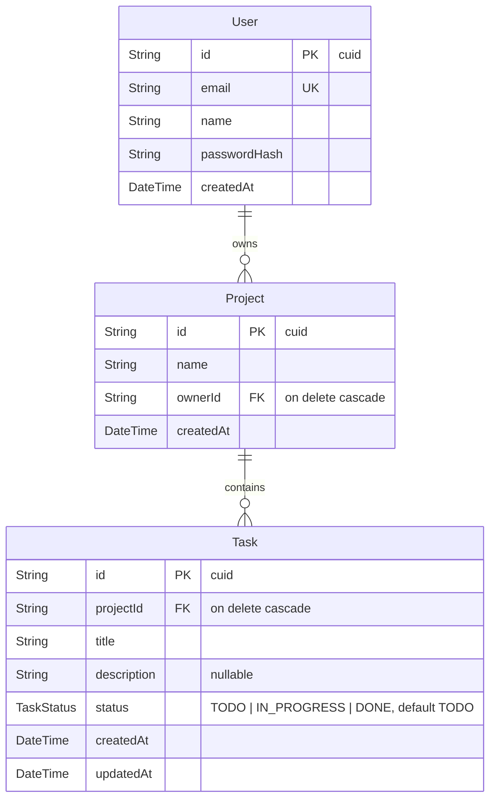

# Architecture

Requirements and the data model are in [prd.md](prd.md) §6–§7; the rules are in [AGENTS.md](../AGENTS.md). Update this file with any schema or layer change.

## Layers

Server components read their initial data by calling the same services directly, with the user id from `getCurrentUserId()` (`src/server/auth/current-user.ts`). Client components change data only through `/api/v1`: the projects page then calls `router.refresh()` to re-render, and the board updates its own state from the API response (see *Board state*). Each service function takes the owner's user id and filters every query on it, so another user's resource looks exactly like a missing one (404). Route handlers are wrapped in `withErrorHandling` (`src/server/http.ts`), which logs unexpected errors on the server and returns a generic `500 INTERNAL_ERROR`.

`src/server/db.ts` builds one `PrismaClient` with the `PrismaPg` driver adapter from `DATABASE_URL`, cached on `globalThis` outside production so Next.js hot reload does not open new connection pools.

## Authentication

Login issues an HS256 JWT (`src/server/auth/token.ts`) in an httpOnly, Secure, SameSite=Lax `session` cookie and returns it in the body for `Authorization: Bearer` clients. `src/proxy.ts` gates every route except `/login`, `/register`, the register/login/logout endpoints, `/api/v1/health`, and the API docs (`/api/docs`, `/api/docs/openapi.yaml`); route handlers verify the token again before touching data. Details and trade-offs: [decisions/001-jwt-cookie-auth.md](decisions/001-jwt-cookie-auth.md).

## Board state

`ProjectBoard` (server component) loads the project and its tasks through the services and passes them to `Board` (client component), which keeps them in `boardReducer` (`src/lib/board.ts`, pure and unit tested). Status changes are optimistic; creating, editing, and deleting wait for the API and then apply the saved task.

## CI/CD

Branch protection requires the CI checks before merging. Dependabot opens weekly update PRs, which go through the same pipeline.

## Database schema

Source: `prisma/schema.prisma`; migrations in `prisma/migrations/`.

`Task` has an index on `(projectId, status)` for loading a board's columns.
