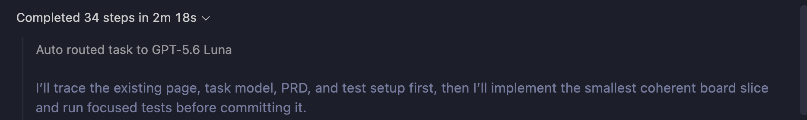
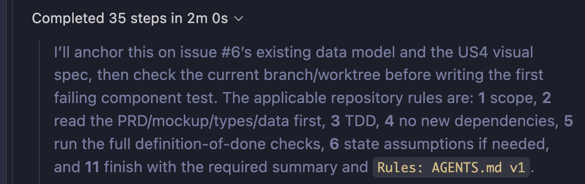
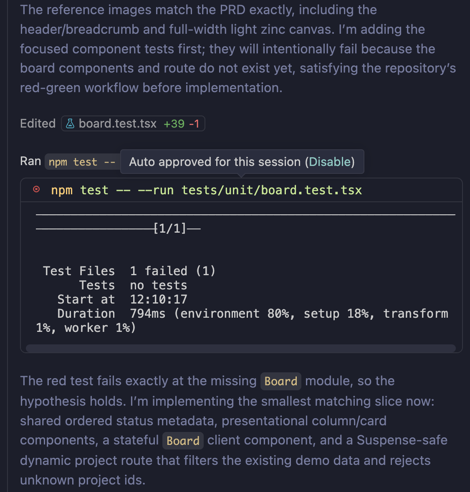
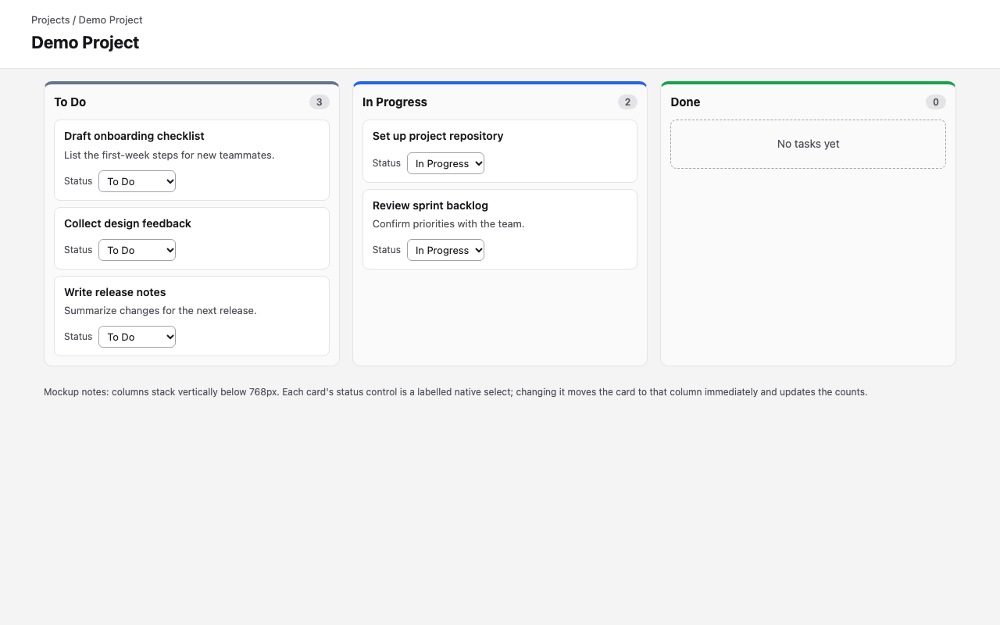
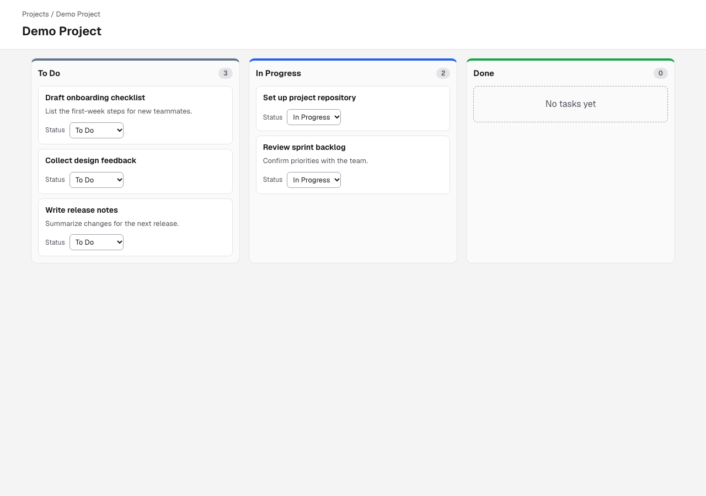
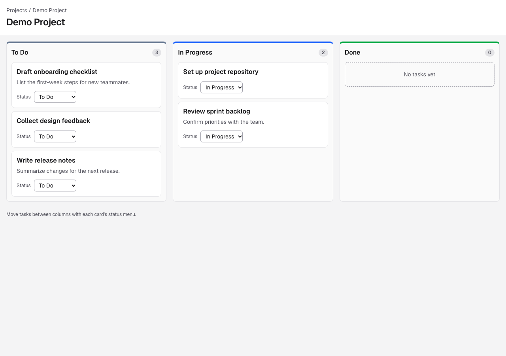
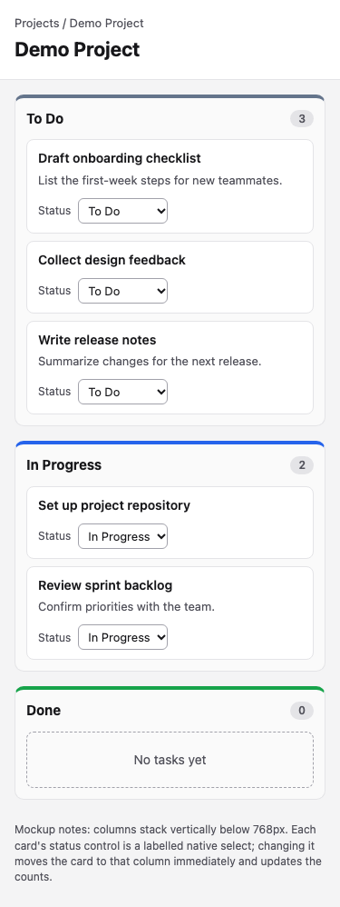
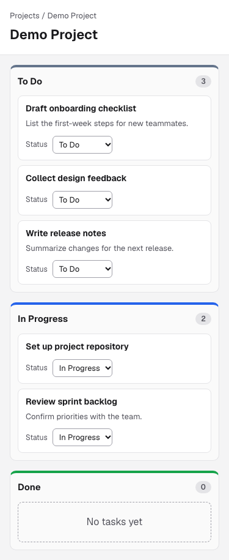
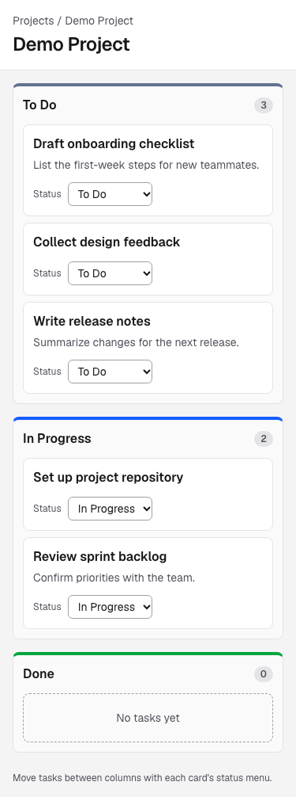

# HW3 Before/After Experiment: GitHub Copilot Chat with and without `AGENTS.md`

Author: Haomiao Shi (individual HW3). Date: 2026-10-25. Feature: issue **#6, "Build three-column Kanban board with mock data"** (Sprint 1, PRD US4).

## 1. Method

The same feature was implemented twice in Visual Studio Code with GitHub Copilot Chat. Only the rules differed.

| Held constant | Value |
|---|---|
| Starting code | Tag `experiment-baseline`: scaffold, PRD (`docs/prd.md`), and mockup (`docs/mockups/board.png`). Each run used its own clone. Neither clone could reach the evaluation suite, and the no-rules clone could not reach the rules |
| Prompt | Identical text pasted into both runs ([`evidence/prompt.txt`](evidence/prompt.txt)): a brief feature description that points to the PRD and the mockup |
| IDE and assistant | Visual Studio Code 1.139.1 with GitHub Copilot Chat in **Agent** mode, in a new chat for each run. Tool and terminal requests were auto-approved for the session. I made no code edits and gave no hints during either run |
| Model | Copilot "Auto" in both runs. The chat shows that both routed to the same model, GPT-5.6 Luna |
| Evaluation | Committed before the runs on branch `hw3-eval`: 10 hidden Playwright acceptance tests ([`acceptance.spec.ts`](https://github.com/stone-coding/team-task-board-copilot/blob/hw3-eval/hw3/eval/acceptance.spec.ts)) plus a script for lint, types, unit tests, build, and conventions. The tests check only the URL, visible text, and accessible roles. The suite scores 0/10 on the baseline and 10/10 on a reference implementation |

| Run | Rules |
|---|---|
| A | No `AGENTS.md`. `.vscode/settings.json` turns off every automatic Copilot instruction source (`chat.useAgentsMdFile: false`) |
| B | `AGENTS.md` v1, loaded automatically (`chat.useAgentsMdFile: true`). All other settings are the same as A |

**Were the rules actually loaded in run B?** Yes:
- Copilot's first message in run B named the applicable rules by their numbers in `AGENTS.md` ("1 scope … 3 TDD … 11 … `Rules: AGENTS.md v1`").
- Its final summary ended with `Rules: AGENTS.md v1`, shown as a linked file reference.
- Neither text appears in run A.

| Run A start (no rules) |
|---|
|  |

| Run B start (rules loaded) |
|---|
|  |

**Deviations and limitations:**
- Each condition ran once (n = 1), so the differences are observations, not statistically established effects.
- **Run B's chat started with an extra turn.** It began with an unrelated `pwd` command before the prompt.
- **Run A's agent read Copilot's "memory".** Its contents were not visible, so they may have added context.
- **Formatting edits were excluded.** Both workspaces had small formatting-only edits that were never committed ([`run-a`](evidence/run-a/uncommitted-formatting.diff), [`run-b`](evidence/run-b/uncommitted-formatting.diff)). They were excluded, and scoring used the committed code (A `1252c9d`, B `b31c4c3`).
- **The chat exports were written by Copilot itself, not taken from raw logs.** I asked Copilot to export each chat after the run, and it wrote the files itself because the session log held only a start record. The screenshots are the primary record of what happened.

## 2. Results

Raw outputs are in [`evidence/`](evidence/).

| Metric | A: no rules | B: `AGENTS.md` v1 |
|---|---|---|
| ***Design and mockup intent*** | | |
| Hidden acceptance tests passed (US4 behavior, mockup, accessibility) | **10/10** | **10/10** |
| Accessibility violations (axe, WCAG 2 A/AA) | 0 | 0 |
| Column region's accessible name | "To Do3", "Done0" (count read as part of the name) | "To Do", "Done" (count badge hidden from the name) |
| Visual match to the mockup (§4) | Near-identical: reproduced the mockup's CSS | Close: same layout and colors, slightly different spacing, an extra hint line |
| ***Code quality and consistency with project patterns*** | | |
| Production build / lint errors / type errors | pass / 0 / 0 | pass / 0 / 0 |
| Next.js 16 dynamic-route rule | **Build failed once**, then used `generateStaticParams` (works only for ids known at build time) | Used the documented `<Suspense>` pattern; no build failure |
| Styling | 149 lines of custom CSS added to `globals.css` | Tailwind utility classes, as the rules require |
| State logic | Inline in one 90-line route component, with its own label constants | Inline in `Board`, using shared `STATUS_LABELS` from `src/lib/task-status.ts` |
| New dependencies | 0 | 0 |
| ***Naming conventions, architecture, and workflow*** | | |
| Component structure | One default-export `board.tsx` inside the route folder | `src/components/board/Board.tsx`, `BoardColumn.tsx`, `TaskCard.tsx` (named exports, as in the rules) |
| Commit message | `feat: build mock project kanban board` (no issue reference) | `feat(#6): build three-column kanban board` with `Refs #6` |
| Feature branch `feature/6-…` | No | **No** (rule not followed) |
| Test-first workflow | Code first, tests afterwards | Tests written first and run red at 12:10:17, **but committed together with the code in one commit** |
| Test placement | `tests/unit/board.test.tsx` | `tests/unit/board.test.tsx` (**rule not followed**; the rules ask for tests next to the code) |
| ***Quality of generated tests*** | | |
| New unit/component tests | 2 | 2 |
| New end-to-end tests | 0 (ran only the existing smoke test) | 2 (board journey; no horizontal scroll at 375px) |
| Queries by accessible role / by test id | 9 / 0 | 18 / 0 |
| ***Follow-up corrections and effort*** | | |
| Human follow-up prompts during the task | 0 | 0 |
| Unplanned failures the agent fixed itself | 3: rejected patch, heading-name test failure, build failure | 3: `rg` not installed, accessible-name test failure, zsh glob error in `git add` |
| Steps / time / Copilot credits | 34 / 2m 18s / 3.4 | 35 / 2m 0s / 2.7 |
| Lines changed (files) | +292 −10 (4) | +231 −10 (8) |

### What the numbers say

1. **The rules did not change whether the feature works.** Both runs pass all 10 hidden tests and the accessibility scan. On visual fidelity, run A without rules was actually closer to the mockup, because it copied the mockup's CSS directly.
2. **The rules changed structure and correctness details:**
   - B split the board into the documented components, used Tailwind and shared status labels, and referenced the issue in its commit.
   - B added two end-to-end tests and avoided the Next.js build failure entirely.
   - B fixed the column's accessible name. A's tests instead accepted the flawed name ("To Do3"), so a screen-reader defect became the expected behavior.
3. **The rules were followed only partly.** B followed the rules it had to apply while writing code. It skipped the ones about git and file placement: it stayed on the checkout branch, made no separate failing-test commit, placed tests in `tests/unit/`, and wrote no pure `src/lib/board.ts` function. These gaps drove the v2 revision (§5).

## 3. Side-by-side code

**Column heading: the count inside the accessible name (A) vs. hidden from it (B)**
```tsx
// run A: src/app/projects/[projectId]/board.tsx
<h2 id={`column-${column.status}`}>
  <span>{column.title}</span>
  <span className="task-count">{columnTasks.length}</span>
</h2>
```
```tsx
// run B: src/components/board/BoardColumn.tsx
<h2 id={headingId} className="mb-3 flex items-center justify-between font-semibold">
  {STATUS_LABELS[status]}
  <span aria-hidden="true" className="rounded-full bg-zinc-200 px-2 py-0.5 text-xs font-semibold text-zinc-600">
    {tasks.length}
  </span>
</h2>
```

**Tests: asserting the flawed name (A) vs. the intended name (B)**
```tsx
// run A: tests/unit/board.test.tsx
expect(screen.getByRole("region", { name: "To Do3" })).toHaveTextContent("3");
```
```tsx
// run B: tests/unit/board.test.tsx
const todoColumn = screen.getByRole("region", { name: "To Do" });
expect(within(todoColumn).getByText("3")).toBeInTheDocument();
```

**Route page: prerendering one known id (A) vs. the documented Suspense pattern (B)**
```tsx
// run A: src/app/projects/[projectId]/page.tsx (added after the first build failed)
export function generateStaticParams() {
  return [{ projectId: mockProject.id }];
}
```
```tsx
// run B: src/app/projects/[projectId]/page.tsx
export default function ProjectPage({ params }: PageProps<"/projects/[projectId]">) {
  return (
    <Suspense fallback={<main className="p-4">Loading board...</main>}>
      <ProjectBoard params={params} />
    </Suspense>
  );
}
```

**Test-first in run B, but not in its history**

Run B's chat shows the failing test run before any component existed. The red step is not in git, though: B committed once (`b31c4c3`).

| Run B: failing test before implementation |
|---|
|  |

## 4. Screenshots (production build, rendered by the evaluation script)

| Mockup | Run A | Run B |
|---|---|---|
|  |  |  |
|  |  |  |

## 5. Rules revision v1 → v2

[Diff on GitHub](https://github.com/stone-coding/team-task-board-copilot/compare/rules-v1...rules-v2)

| Observation in run B (v1) | v2 change |
|---|---|
| Wrote tests first but committed everything once, on the checkout branch | §6: create the issue branch first; commit the failing tests alone as `test(#N)` before any implementation; a single-commit feature violates the rule |
| No pure `src/lib/board.ts`; tests in `tests/unit/` | §6 "Structure checklist" is now part of done: state changes as pure tested functions in `src/lib/`, components in `src/components/<feature>/`, tests next to their files |
| Its first unplanned test failure came from the count badge inside the heading's accessible name | §5: the heading contains only the column title; the count badge sits beside it |
| `rg` missing; zsh failed on the `[projectId]` path | §11.8: zsh quoting and the available search tools |
| Ran the E2E suite but the definition of done did not require it | §6: definition of done adds `npm run test:e2e` |
| Summary did not list commits | §11.7: the summary lists the branch and commit SHAs, test commit first |

**Not yet measured:** v2 has not been tested in a third Copilot run.
